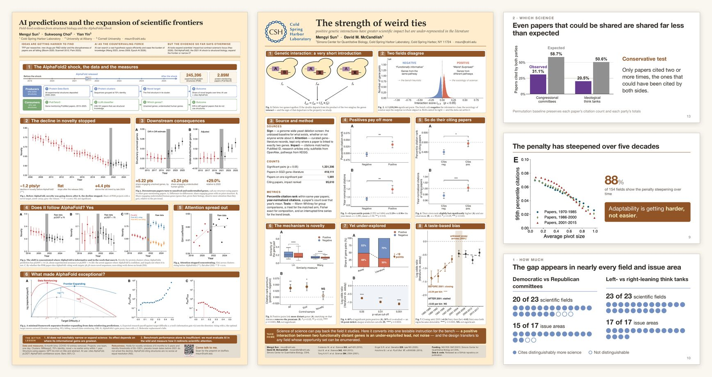
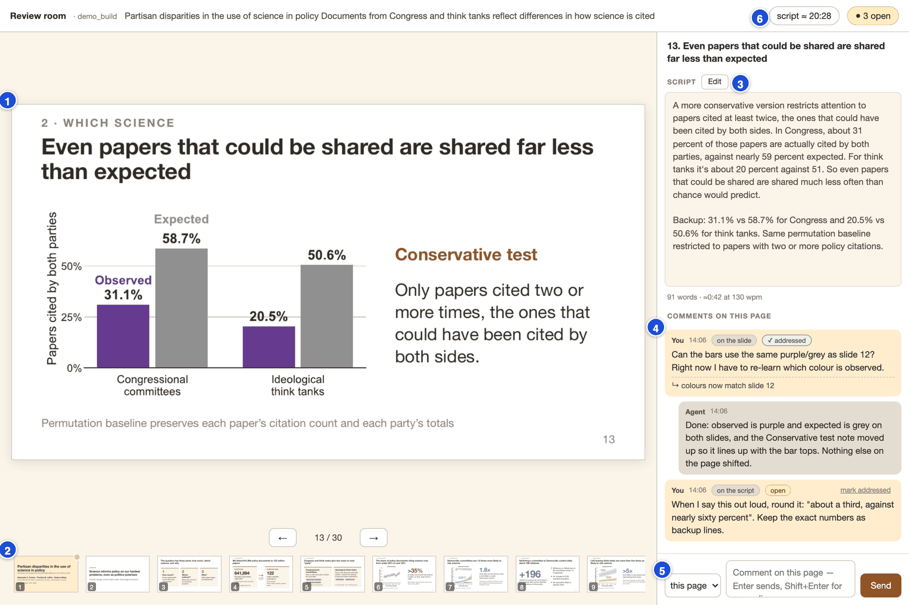
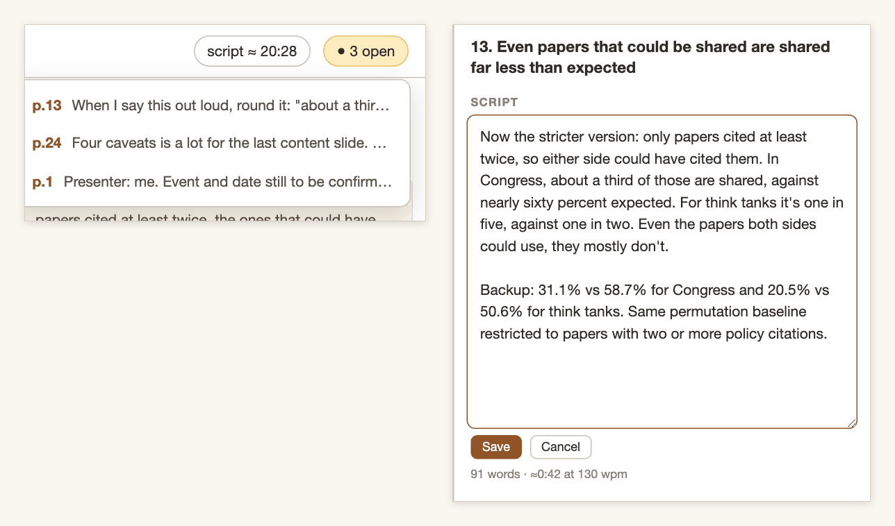
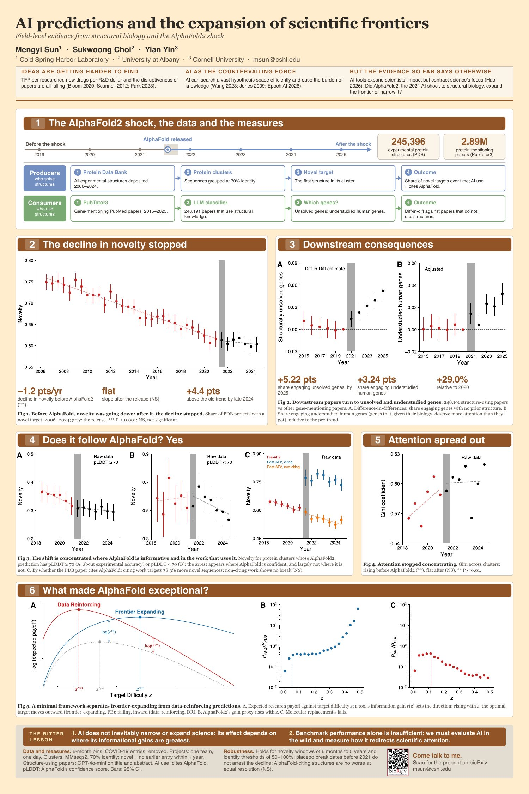
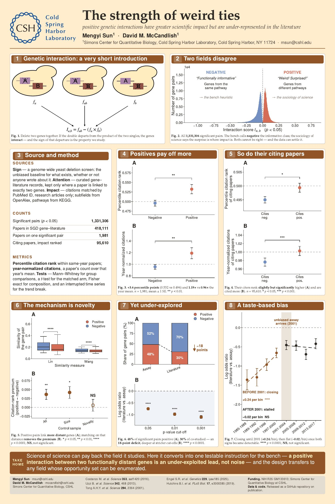
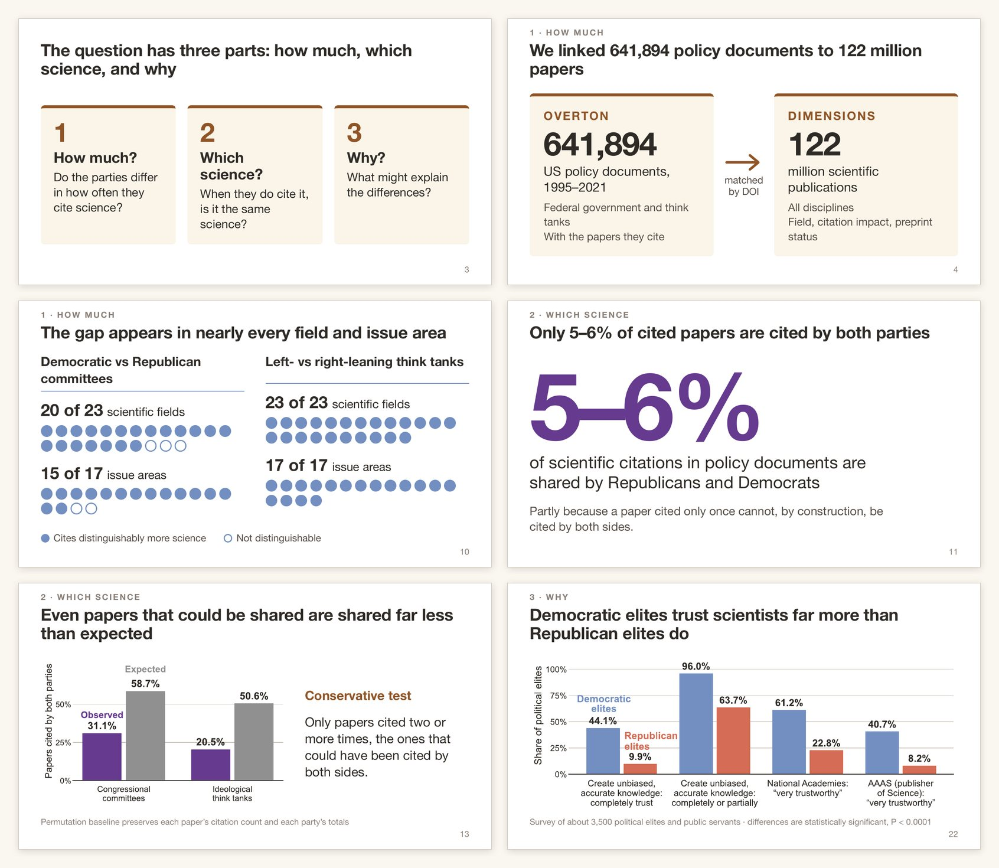
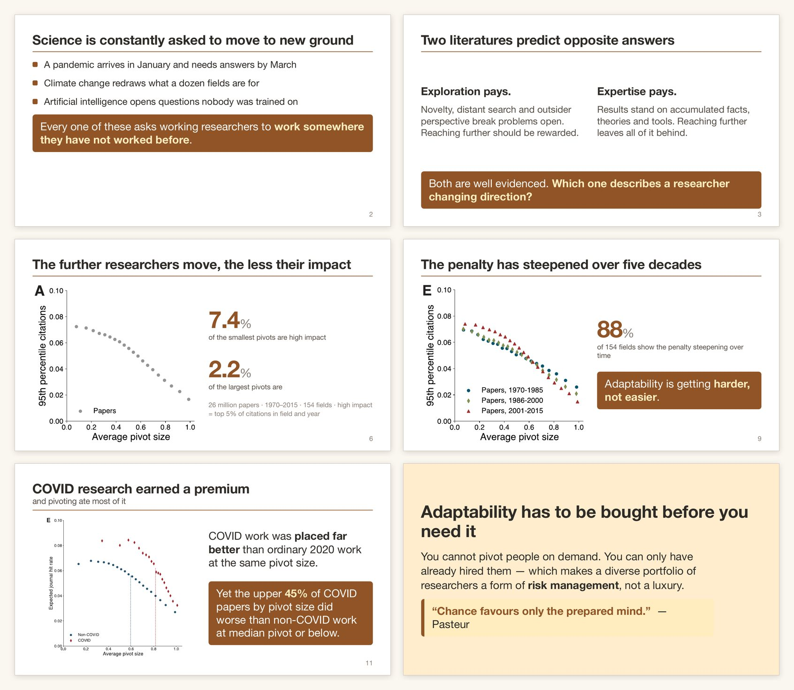

# scicomm-skills

**Conference posters and research talks, made by your coding agent and checked
before they reach the printer or the projector.**

Two [Agent Skills](https://agentskills.io/) for
[Claude Code](https://claude.com/claude-code),
[Codex](https://developers.openai.com/codex/) and [Cursor](https://cursor.com/):

- **`master-of-poster`** turns a paper, a slide deck, a codebase or a folder of
  figures into a print-ready conference poster: a PDF at the exact sheet size.
- **`master-of-slides`** turns the same kinds of material into a talk: a slide
  deck (PDF, or PowerPoint for collaborators), a script of what to say on every
  slide, and a **review room** in your browser where you comment page by page
  and the agent works through your comments.

<p align="center">
  
</p>

Under the hood, the agent writes the poster or deck as a web page, prints it to
PDF in a headless browser, and then **measures the result**: text running past
the edge, a box silently cut off, type too small to read from the back of the
room, colours without enough contrast. It fixes what it finds before you ever
see the file.

## Install

Give your coding agent the link and ask it to install:

> Install the skills from https://github.com/mengysun/scicomm-skills

It clones this repository and connects both skills to Claude Code, Codex and
Cursor at once. (Agents: the procedure is in [INSTALL.md](INSTALL.md), which
also covers the shared environment, the scripts, the colour palette and the
review room's security.)

Or do it yourself in two lines:

```bash
git clone https://github.com/mengysun/scicomm-skills.git ~/scicomm-skills
~/scicomm-skills/install.sh
```

The one thing you may need to install yourself is **poppler**, a small PDF
toolkit: `brew install poppler` on a Mac, `apt install poppler-utils` on
Ubuntu or Debian. Everything else (a headless browser, the plotting library) the
skills set up on their own the first time you use them, which takes about a
minute once.

To update later, ask your agent to update the skills, or run
`git -C ~/scicomm-skills pull`.

## Using it

Open your agent in the folder that holds your material (the paper PDF, the
figures, the analysis code) and call the skill:

| | Talk | Poster |
|---|---|---|
| Claude Code (terminal, desktop app, IDE) | `/master-of-slides` | `/master-of-poster` |
| Codex | `$master-of-slides` | `$master-of-poster` |
| Cursor | `/master-of-slides` in Agent chat | `/master-of-poster` in Agent chat |

You don't have to name the skill. Asking for "a 15-minute talk from paper.pdf"
or "a 36×48 poster of this project" is enough for the agent to pick it up.

### Making a talk

```text
/master-of-slides Make a 15-minute conference talk from paper.pdf.
The audience is economists, not biologists. The plotting code is in analysis/.
```

1. **Two quick questions**, answered by clicking an option where your agent
   offers them: PDF or PowerPoint (or both)? 16:9 or 4:3? Put the
   length of your slot and who is in the room in your request: they decide how
   many slides there are and which terms need defining.
2. **The outline, for your approval.** The agent reads your material and writes
   the talk as a list of slide titles, each one a claim ("Treated plots yield
   more", not "Results"), so the titles read alone tell the story. It stops here
   so you can reorder or cut before anything is built.
3. **The build.** It designs the slides and redraws your figures at a size that
   reads on a projector when it has the code or data, or places the originals
   untouched when it doesn't. Then it renders the deck and checks every page
   until nothing overflows and nothing is too small or too faint.
4. **The script.** A final pass writes what you will say on every slide: how
   you get there from the previous one, the point in speakable sentences, what
   to point at, `[CLICK]` cues, and backup numbers for questions. It is paced at
   about 130 words a minute so the talk fills 70–80% of your slot.
5. **Hand-over.** You get the deck, the script, a short note on what was
   checked and what was left for you to decide, and a link to the review room.

### Making a poster

```text
/master-of-poster Make a 36×48 in portrait poster from paper.pdf for <conference>.
Logos are in logos/.
```

1. **One question: the sheet.** Pick the size and orientation your venue
   wants (A0 portrait, 36 × 48 in portrait, 48 × 36 in landscape) or type your
   own. Put it in your request to skip the question.
2. **The content plan, for your approval.** The title, the one sentence a
   visitor should walk away with, and the sections in order, each with its
   claim and its figure. It stops here so you can reorder before any layout
   exists.
3. **The build.** It lays the poster out, renders it at full size, and checks
   it: how much of the sheet goes to figures, the smallest type, contrast,
   anything clipped or spilling over. It revises until the poster passes.
4. **Hand-over.** The print PDF, a preview image, and a note on what was
   checked. Every number on the sheet traces back to your material; anything
   it couldn't find is left as a visible `[[TODO: …]]` rather than made up.

### Where things go

Everything lands in a build folder beside your material. Your own files are
never edited:

```text
deck_build_1/
├── pdf/deck.pdf        the deck (poster_build_1/pdf/ for a poster)
├── pptx/deck.pptx      if you asked for PowerPoint
├── notes/deck.md       the script, page by page
├── preview/            one image per slide
├── review/             the review room and your comments
├── content.md          the outline, and where every number came from
└── README.md           what was checked, what was left for you to decide
```

Each round of changes goes into a new folder (`deck_build_2`,
`poster_build_2`, …), so the version you already looked at is still there to
compare against.

## The review room

When a deck is finished, the agent starts a small web page on your own
computer and sends you the link. It shows each slide beside the words you will
say over it, with a comment thread for that page.

<p align="center">
  
</p>

1. **The slide**, as it will be projected. Move with the ← → buttons or the
   arrow keys.
2. **Every page at a glance.** A dot marks pages with comments still open.
3. **The script for this page**, with its word count and speaking time.
   **Edit** lets you rewrite it in your own words.
4. **The comment thread.** Your comments, the agent's replies, and what was
   done about each one.
5. **Write a comment.** Aim it at the whole page, the slide, or the script.
   Enter sends.
6. **The whole talk:** total speaking time and the number of open comments.

<p align="center">
  
</p>

Click the open-comment count to see every open comment in the deck and jump to
any of them (left). Rewrite a script in your own voice (right): the agent keeps
your text word for word and only fixes typos when it puts it into the deck.

**When you're done, say so in the chat** ("I've finished reviewing"). The
agent reads all your comments and script edits, makes the changes in a new
build folder, checks the new deck, and answers each comment in its thread,
saying what changed or why it didn't. The page you have open switches to the
new round by itself.

Comments are saved as plain files in the build folder, so nothing is lost if
the page or the agent closes. A later session can pick up where you left off:
"address the open comments on deck_build_2".

The room runs only on your computer, and its link contains a private key.
Share it only with people using the same machine.

## Examples

### Posters

<table>
  <tr>
    <td width="50%" valign="top">
      <a href="docs/images/poster-ai-predictions.jpg"></a>
    </td>
    <td width="50%" valign="top">
      <a href="docs/images/poster-weird-ties.jpg"></a>
    </td>
  </tr>
  <tr>
    <td><em>AI predictions and the expansion of scientific frontiers</em>, 36 × 54 in</td>
    <td><em>The strength of weird ties</em>, 36 × 54 in</td>
  </tr>
</table>

Two posters by this repository's author. Click either one for full size.

### Talks

**Partisan disparities in the use of science in policy**, a 20-minute talk
built from Furnas, LaPira & Wang,
[*Science* 388, 362–367 (2025)](https://doi.org/10.1126/science.adt9895), and its
supplementary materials. 30 pages, 16:9, delivered as PDF and PowerPoint with a
full script. The charts here were drawn by the agent from numbers printed in
the paper; where the deck uses the paper's own figures, they are placed
unmodified.

<p align="center">
  
</p>

**Adaptability and the pivot penalty**, a 12-minute conference talk built from
Hill, Yin, Stein, Wang, Wang & Jones, *Adaptability and the Pivot Penalty in
Science and Technology* (2024 preprint). Here every figure is cropped,
unmodified, from the paper, and the agent built each slide around one: a claim
for a title, the numbers that matter, and a takeaway.

<p align="center">
  
</p>

Both talks are demonstrations built from published papers; the research and
its figures belong to their authors.

## Tips

- **Ask for several versions at once.** "Give me three different layouts", or
  "two outlines: one for specialists, one for a general audience". The agent
  can build them side by side, and if they're decks in the same build folder,
  the review room gets a switcher to flip between them and comment on each.
  Pick one, or ask it to combine what you liked.
- **You don't need the biggest model.** Sonnet 5.5 with a higher thinking
  (effort) level already does this well.
- **Point it at your plotting code or data, not just the PDF.** With the code,
  the agent redraws each figure at the size it will be seen, in the deck's
  colours. From a PDF it can only crop, and journal figures are drawn with tiny
  type.
- **Say your constraints up front:** venue, poster size or talk length,
  audience, who is presenting, and any template from your institution (a
  `.pptx` or `.potx` file).
- **Fill in the `[[TODO]]`s.** The agent never invents a venue, a date or a
  number; it leaves a marker you can't miss.
- **Choose PDF unless someone else must edit it.** The PDF is checked end to
  end and looks the same on any projector. Ask for PowerPoint, or both, when a
  co-author needs to work on the file.
- **Small changes are one message:** "shorten the title on slide 4", "make
  the take-home bigger". Every change is re-rendered and re-checked.
- **Read the build folder's README.** It lists what was measured, what was
  deliberately left for you to decide, and any inconsistencies found in your
  source (a number that differs between the main text and the supplement, for
  instance).

## License

MIT. See [LICENSE](LICENSE).
